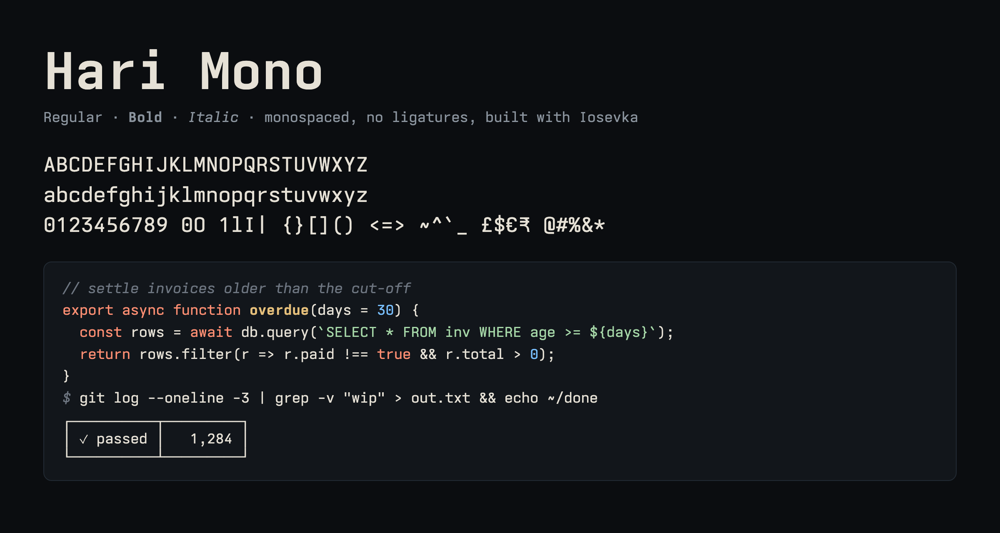

# Hari Mono

A monospaced font for terminals and code editors, built with [Iosevka](https://github.com/be5invis/Iosevka) and shaped in the spirit of Berkeley Mono.



## What it looks like

- Wide, even characters (600 units per cell) with a calm, technical feel.
- Characters that are easy to confuse look clearly different: a dotted `0`, separate shapes for `1`, `l` and `I`, and square dots on `i`, `j` and punctuation.
- A single-storey `g`, a flat-topped `3` and flat-sided brackets.
- No ligatures. What you type is what you see: `=>`, `>=` and `!==` stay as typed.
- Terminal spacing, so box-drawing characters and arrows fill the cell exactly.
- Four styles: Regular, Bold, Italic and Bold Italic. The italics are slanted versions of the upright letters, so code reads the same in both.

## Downloads

Grab the latest archives from the [Releases](https://github.com/vimalhari/hari-mono/releases) page.

| Archive | Contents | Use it for |
|---|---|---|
| `HariMono.zip` | TTF, hinted and unhinted | Everyday use. Hinted renders better on Windows; unhinted is ideal on macOS and Linux. |
| `HariMono-NerdFont.zip` | TTF with over 10,000 [Nerd Fonts](https://www.nerdfonts.com) icons built in | Shell prompts and tools that show file, Git and language icons. |
| `HariMono-Web.zip` | WOFF2 and a ready-made CSS file | Websites and documentation. |

## Installing

- **macOS:** double-click each `.ttf` and choose Install, or copy them to `~/Library/Fonts`.
- **Windows:** use the files in `Hinted`. Select them all, right-click and choose Install.
- **Linux:** copy them to `~/.local/share/fonts`, then run `fc-cache -f`.

Then select the font by name:

```ini
# Ghostty
font-family = "Hari Mono"
```

```jsonc
// VS Code settings.json
"editor.fontFamily": "'Hari Mono', monospace",
"terminal.integrated.fontFamily": "'HariMono Nerd Font Mono'"
```

The Nerd Font version is named **HariMono Nerd Font Mono**.

On the web:

```html
<link rel="stylesheet" href="hari-mono.css">
<style>code, pre { font-family: "Hari Mono", monospace; }</style>
```

## How it was made

Hari Mono starts from the glyph choices and proportions of [Ioskeley Mono](https://github.com/ahatem/IoskeleyMono), then goes character by character:

1. Every printable ASCII character was compared against Berkeley Mono at large size.
2. Each of Iosevka's alternative shapes for that character was scored for closeness, and the final pick was made by eye.
3. Iosevka cannot set the size of individual symbols, so `postprocess.py` fits seventeen of them, such as brackets, `< > ^ ~` and the underscore, to the sizes and positions in [`data/symbol-fit.json`](data/symbol-fit.json). These values are tuned to Berkeley Mono's proportions. Narrower symbols are taken from a second, narrower Iosevka build, so their strokes stay exactly as heavy as the letters.

Every outline in Hari Mono is Iosevka's own. Nothing is traced or copied from Berkeley Mono.

## Building from source

You need Git, Node.js, [pnpm](https://pnpm.io), [uv](https://docs.astral.sh/uv/), [ttfautohint](https://freetype.org/ttfautohint/) and [FontForge](https://fontforge.org).

```sh
./build.sh     # fonts into dist/ (fetches the pinned Iosevka release on first run)
./package.sh   # release archives into dist/release/
```

The design lives in [`private-build-plans.toml`](private-build-plans.toml) (Iosevka's build plan format) and [`data/symbol-fit.json`](data/symbol-fit.json).

## Licence and acknowledgements

Hari Mono is released under the [SIL Open Font License 1.1](LICENSE). You can use it freely in personal and commercial work. If you redistribute the font or a modified version, follow the conditions in the licence.

- **Iosevka** by Renzhi Li (Belleve Invis) provides every outline and the build system.
- **Ioskeley Mono** by Ahmed Hatem provided the starting configuration.
- **Nerd Fonts** icons keep their own licences, included in the Nerd Font archive.
- **Berkeley Mono™** is a commercial typeface by [U.S. Graphics Company](https://usgraphics.com/products/berkeley-mono), and it inspired the look of Hari Mono. Hari Mono is an independent project, not affiliated with or endorsed by U.S. Graphics Company. If you like the original, please consider buying it; supporting independent type designers helps more good typefaces get made.
